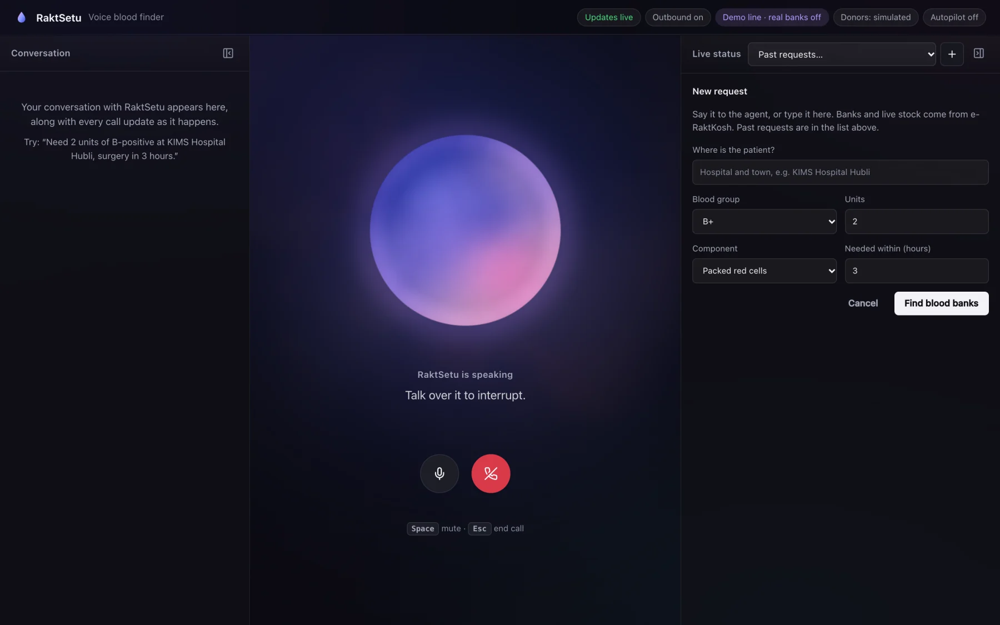
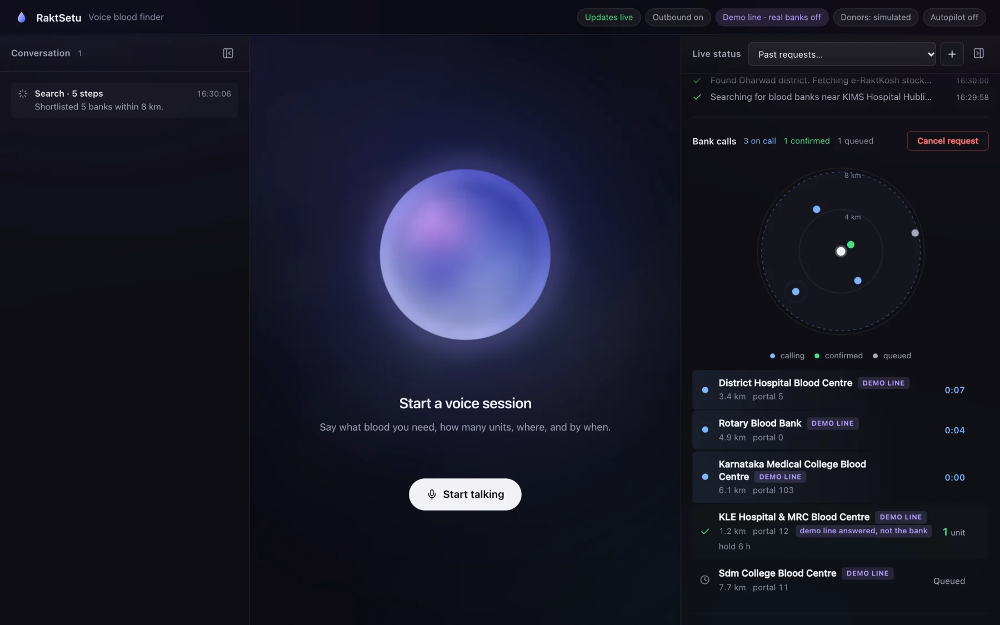
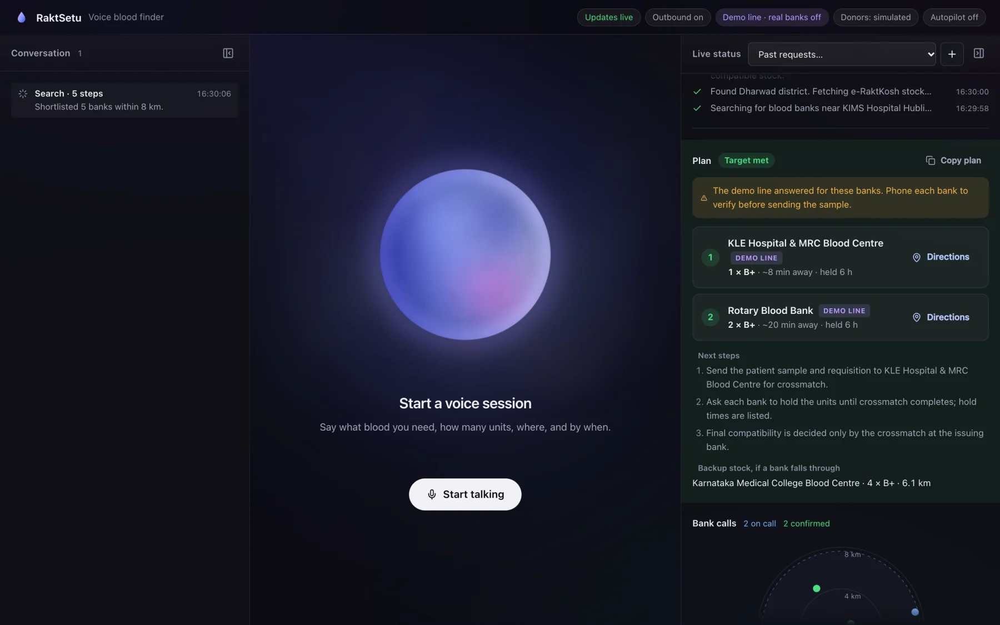
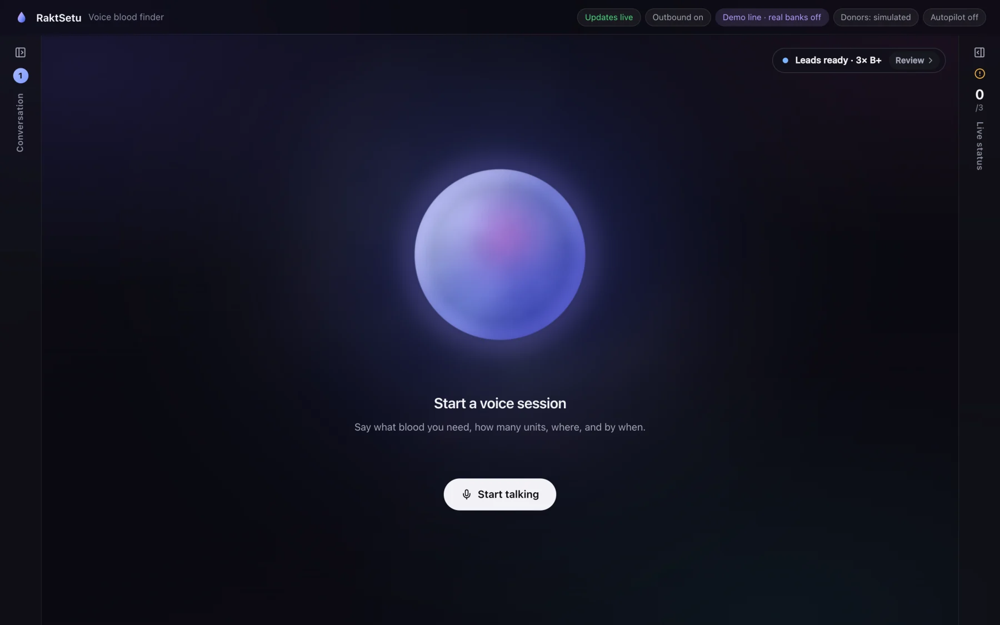
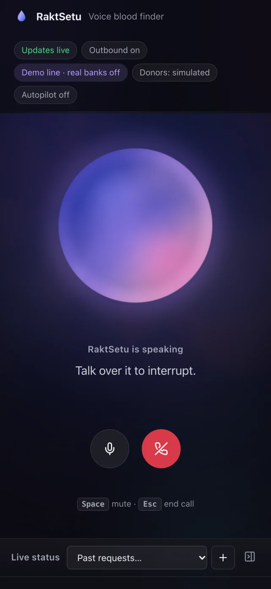
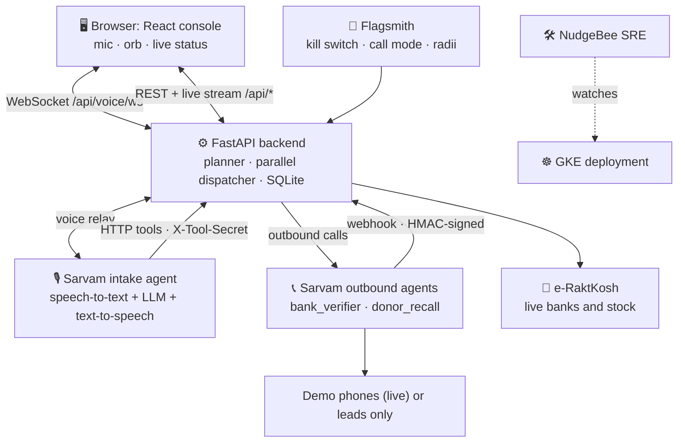

<div align="center">

# 🩸 RaktSetu

**Say what blood you need. RaktSetu finds it, and phones the banks to prove it.**

A voice-first blood-unit finder for hospital blood-centre coordinators: one spoken request becomes a
parallel, phone-verified search across blood banks, plus donor recall for restock.




</div>

---

## Why this exists

Every year around Diwali and the year-end holidays, blood banks run short. Camps stop because colleges and offices
close, and donors travel. Maharashtra's State Blood Transfusion Council calls this an annual shortage. Hospitals
still find blood by phoning banks one by one. The national e-RaktKosh portal is meant to show daily stock, but many
banks don't update it (93 Maharashtra government banks were fined for missing daily updates), so
**portal numbers are leads, not facts.**

## How it works

_An example conversation:_

> 🗣️ **You:** "Need 2 units of B-positive at KIMS Hospital Hubli, surgery in 3 hours."
> 🤖 **RaktSetu:** "I found 11 banks in Dharwad district. Shall I call the nearest one now?" → **"Yes."**
> 📞 It phones, narrates what each bank says, and shows a bank's answer next to what the portal claimed.
> ✅ "2 of 2 confirmed. Nearest is KLE Hospital, about 8 minutes. Send the patient's sample and requisition there for crossmatch."

1. **Ask** by voice (or type it).
2. **Find leads.** The backend pulls real banks, phone numbers and live stock from e-RaktKosh and ranks them by distance.
3. **You approve** the calls. Nothing is dialled without a human "yes".
4. **Calls go out in parallel.** Results stream into the screen as they land.
5. **You get a plan:** who to collect from, in what order, and the crossmatch step.

## The app

<table>
<tr>
<td width="50%"><br><sub><b>Live call board.</b> Ringing calls with timers, results gliding into place, and a radar of banks by real distance.</sub></td>
<td width="50%"><br><sub><b>The plan.</b> Ranked banks, directions, next steps, backups, and one tap to copy it.</sub></td>
</tr>
<tr>
<td width="50%"><br><sub><b>Focus mode.</b> Collapse either sidebar (<kbd>[</kbd> and <kbd>]</kbd>); anything needing approval surfaces as a pill.</sub></td>
<td width="50%" align="center"><br><sub><b>On a phone.</b> The same console, stacked.</sub></td>
</tr>
</table>

<sub>The board and plan screenshots come from the dev-only demo mode (`/#boarddemo`), which runs a looping fake request
so no real call is placed. Names and numbers in them are synthetic.</sub>

### Highlights

| | |
|---|---|
| 🎙️ **Voice in the browser** | Talk to the agent from the page. Interrupt it any time. Your Sarvam key never reaches the browser. |
| 🔮 **Calm orb** | A gradient orb that breathes with the agent's voice, shifts when you speak, and ripples when a session starts. |
| 📞 **Phone-verified** | Only units a bank confirms on the phone count. Portal-vs-phone mismatches are shown. |
| 🛰️ **Live status** | Ringing timers, a bank radar, and a step-by-step feed of what the backend is doing. |
| 🧾 **A plan you can use** | Ranked banks, directions, crossmatch steps, backups, and a **Copy plan** button. |
| 🛡️ **Demo-safe by default** | No real bank is dialled unless a Flagsmith flag allows it. Demo calls are labelled. |
| ⌨️ **Keyboard** | <kbd>Space</kbd> mutes, <kbd>Esc</kbd> ends the call. |

---

## Quick start

> **No API keys needed.** Without them the app runs in a safe mode: it finds real banks and stock from e-RaktKosh
> but **never places a phone call**. Voice needs Sarvam keys (see [Voice](#voice)).

**You need:** Python 3.12+, Node 20+, git.

```bash
# 1. Get the code
git clone https://github.com/mavihsrr/raktsetu.git && cd raktsetu

# 2. Backend
python3.12 -m venv .venv && source .venv/bin/activate
pip install -e ".[dev]"
cp .env.example .env            # leave the Sarvam and phone lines empty for now

# 3. Frontend (the backend serves the built app)
cd frontend && npm install && npm run build && cd ..

# 4. Run
uvicorn app.main:app --port 8000
```

Open **http://localhost:8000**. Type a request (for example *KIMS Hospital Hubli, B+, 2 units*) in the right panel and
press **Find blood banks**. The interactive API docs are at **http://localhost:8000/docs**.

> Pulled new code and the backend won't start? Re-run `pip install -e ".[dev]"`; dependencies change now and then.

### Working on the frontend

```bash
# terminal 1: backend
uvicorn app.main:app --reload --reload-dir app --port 8000

# terminal 2: frontend with hot reload, proxied to the backend
cd frontend && npm run dev          # http://localhost:5173
```

| Command (in `frontend/`) | What it does |
|---|---|
| `npm run dev` | Dev server on :5173 (proxies `/api` and the voice socket to :8000; set `VITE_BACKEND` to point elsewhere) |
| `npm run build` | Type-check and build to `frontend/dist`, which the backend serves at `/` |
| `npm test` | Frontend tests (vitest) |
| `npm run lint` | ESLint |

**Dev-only demo modes** (only with `npm run dev`; not in the production build). Reload after changing the `#`:

- `http://localhost:5173/#orbdemo` cycles the orb through every voice state with synthetic audio.
- `http://localhost:5173/#boarddemo` runs a looping fake request through the call board, radar and plan, without placing calls.

---

## Voice

Browser voice relays your microphone to a Sarvam intake agent through the backend (`WS /api/voice/ws`), so the API key
stays on the server.

**To enable it:**

1. Install the Sarvam SDK: `pip install "sarvam-conv-ai-sdk>=1.1"`.
2. Fill in the Sarvam values in `.env` (`SARVAM_API_KEY`, `SARVAM_ORG_ID`, `SARVAM_WORKSPACE_ID`, `SARVAM_CONNECTION_ID`,
   `SARVAM_AGENT_PHONE`, and `SARVAM_INTAKE_APP_ID` / `SARVAM_INTAKE_APP_VERSION`).
3. Restart the backend. `GET /api/flags` should now report `"voice_ready": true`.
4. Open the app in **Chrome** and press **Start talking**. The mic needs `localhost` or HTTPS.

If voice isn't configured, the page says so and the typed request form still works.

**Known limitation:** on laptop speakers the agent can hear itself, because the browser can only cancel echo it knows
about. Headphones avoid it. Details and fixes are in [`FRONTEND.md`](FRONTEND.md).

---

## Configuration

Copy `.env.example` to `.env`. Never commit `.env`.

<details>
<summary><b>All settings</b></summary>

| Group | Settings |
|---|---|
| Backend | `TOOL_SECRET`, `WEBHOOK_SECRET` (long random strings), `PUBLIC_BASE_URL`, `DASHBOARD_TOKEN` (optional), `SIM_SPEED`, `DB_PATH`, `CORS_ORIGINS` |
| Sarvam | `SARVAM_API_KEY`, `SARVAM_ORG_ID`, `SARVAM_WORKSPACE_ID`, `SARVAM_CONNECTION_ID`, `SARVAM_AGENT_PHONE`, `SARVAM_{BANK,DONOR,INTAKE}_APP_ID` and `_APP_VERSION` |
| Phones | `LIVE_TARGETS`, `DEMO_BANK_PHONES`, `DEMO_DONOR_PHONES` (our own phones that stand in for banks and donors) |
| Flagsmith | `FLAGSMITH_ENVIRONMENT_KEY`, optional `LOCAL_FLAGS_PATH` |
| Monitoring | `NUDGEBEE_WEBHOOK_URL` (optional) |

</details>

### Demo-safe calling (the default)

No real bank or donor is ever phoned by default. Who gets dialled is decided by Flagsmith:

| Flag | Default | What it does |
|---|---|---|
| `outbound_calls_enabled` | on | Kill switch. Off = nobody is dialled; re-read before every dial. |
| `call_mode` | `simulated` (the deployed Flagsmith sets `live`) | `live` = ring the demo phones; `simulated` = ring no one. |
| `call_real_banks` | **off** | On = dial the REAL bank numbers from e-RaktKosh. Flagsmith-only: no local override can turn it on. |
| `call_donors` | on | On = also ring the demo donor line to restock the bank; off = banks only. |

In the deployed setup (`call_mode=live`, real banks off), the top bank in the shortlist is phoned on `DEMO_BANK_PHONES` (the agent still names the real bank),
the donor restock call goes to `DEMO_DONOR_PHONES`, and the other shortlisted banks are listed as leads with their real
numbers. The app labels every demo call **Demo line** and says "demo line answered, not the bank". Without Flagsmith
configured, it falls back to safe defaults (nobody is phoned).

---

## Correctness rules

Built into the code, and shown honestly in the UI:

1. **Portal stock is an unverified lead.** Only units a bank **confirms on the phone** count. Portal-vs-phone
   mismatches are shown.
2. **Donors never count toward the patient's units.** Donated blood must be screened first. Donors are restock or
   replacement and are shown separately.
3. The plan always says: **send the patient's sample and requisition to the bank for crossmatch.** Final compatibility
   is decided only by the crossmatch.
4. Whole blood and platelets: same group only. Packed red cells: red-cell compatibility table, with the exact group
   preferred.
5. Donor recall needs: opted in to recall (consent, DPDP), age 18–65, ≥90 days since the last donation (men) or
   ≥120 days (women).
6. Two human-in-the-loop gates: starting calls is refused unless confirmed, and wave 2 waits for approval (unless the
   Flagsmith `autopilot_mode` flag is on).
7. Distances and locations are never guessed: an unknown distance says "distance unknown", and Directions appear only
   for banks with known coordinates.

---

## Architecture



The backend is deterministic Python with no agent framework: `find_leads → start_calls → get_status → approve_wave2`.
State lives in SQLite (requests, calls, events), so in-flight work resumes after a restart; live updates stream to the
page over SSE.

| Sponsor | Used for |
|---|---|
| **Sarvam AI** | Intake voice agent, outbound `bank_verifier` and `donor_recall` agents, telephony |
| **Flagsmith** | Operator flags: kill switch (re-read before every dial), `call_mode`, parallelism, autopilot, radii. Safe defaults if unreachable |
| **NudgeBee** | SRE copilot on the Kubernetes deployment: pod-kill demo → RCA → restart; the app resumes in-flight calls |

---

## API

Interactive docs: `/docs`.

| Endpoint | Purpose |
|---|---|
| `POST /tools/find_leads` | Plans the search and calls nobody. Returns `request_id` and `say` |
| `POST /tools/start_calls` | `{request_id, confirmed}`. Refused without `confirmed=true` |
| `POST /tools/get_status` | Long-poll ≤25 s. Returns `say`, `needs_approval`, `done`, `plan` |
| `POST /tools/approve_wave2` / `cancel_request` | Human-in-the-loop #2, or stop |
| `POST /webhooks/sarvam/{call_id}?sig=` | Sarvam outbound result |
| `GET /api/requests[/{id}]`, `GET /api/stream` (SSE), `GET /api/flags` | The console |
| `WS /api/voice/ws` | Browser voice relay |
| `GET /healthz` | Liveness and readiness |

The full contract and the UI rules are in [`FRONTEND.md`](FRONTEND.md).

---

## Deployment

Runs on a GKE Autopilot cluster (`raktsetu`, project `festivehackbuild`, `asia-south1`) behind an in-cluster ngrok
agent that serves a fixed HTTPS domain, so Sarvam's tool URLs never change. One replica (Recreate strategy), SQLite on
a 1 Gi volume, and a `/healthz` probe. The Docker image builds the React app and the backend together.

```bash
deploy/deploy.sh             # builds the COMMITTED code (git HEAD) with Cloud Build and rolls it out
deploy/deploy.sh --no-build  # re-applies secrets (from .env) and manifests only
```

- Manifests: `deploy/k8s/raktsetu.yaml`. Secrets are created from `.env` and the local ngrok config at deploy time and
  are never committed.
- Run it from a machine with the **production** `.env`: the cluster's secrets are rebuilt from it.
- After a restart, a search resumes only if it started in the last 10 minutes; older ones are closed without phoning
  anyone.
- Monitoring: Prometheus-style `/metrics` (aggregate counters only) with a scrape config and alert policies under
  `deploy/`.

### Going live from scratch

1. Fill in `.env`: Sarvam keys and IDs, `FLAGSMITH_ENVIRONMENT_KEY`, and the demo phones.
2. Give Sarvam a public URL for tool calls: a tunnel (`ngrok` / `cloudflared`) or the GKE deploy; set `PUBLIC_BASE_URL`.
3. Create the 3 Sarvam agents from `agents/*.md`. Add the HTTP tools in `agents/tools.json` to the intake agent.
4. In Flagsmith, create the flags (`scripts/flagsmith_setup.py`), then set `call_mode=live`.

---

## Testing

```bash
pytest -q                      # backend
cd frontend && npm test        # frontend (truthfulness rules: where calls ring, donors, demo-line labelling, plan)
```

Rehearse the voice conversation with no Sarvam credits (a script plays the agent's part):

```bash
python voice/rehearse.py       # you answer yes/no
python voice/rehearse.py --auto
```

> **Known issue:** some tests in `tests/test_flow.py` were failing when last checked and need updating to match the
> latest backend changes.

---

## Project layout

```
raktsetu/
├── app/            FastAPI backend: coordinator, planner, dialer, flags, voice relay, e-RaktKosh
├── frontend/       React + Vite + TypeScript voice console (built into the backend image)
├── agents/         Sarvam agent prompts and the HTTP tool definitions
├── voice/          Laptop voice client and rehearsal scripts
├── deploy/         Cloud Build and Kubernetes manifests, monitoring
├── static/         The original single-file dashboard (still served at /legacy)
├── scripts/        Flagsmith setup
├── tests/          Backend tests
└── docs/           Screenshots
```

## More documentation

| Doc | For |
|---|---|
| [`ONBOARDING.md`](ONBOARDING.md) | New to the project: running it, git workflow, who to ask |
| [`FRONTEND.md`](FRONTEND.md) | The API contract, UI correctness rules, and how browser voice works |
| [`DESIGN.md`](DESIGN.md) | The visual system: colour, type, the orb, the board |
| [`PRODUCT.md`](PRODUCT.md) | Who it's for and the principles behind it |

## Data and stats used

- Mumbai consumes 500–1,000 units/day (SBTC).
- BMJ Global Health 2024: 8 states with 46% of India's population are effectively "blood deserts", with 0.68 units per
  1,000 people reachable within 60 minutes.
- Pune and Chhatrapati Sambhajinagar reported post-Diwali shortages in Nov 2024.

## Roadmap

Contact-sync (a family's phonebook to find donors), a map view, real e-RaktKosh integration beyond lookups, an SMS
fallback, and multi-hospital routing.
